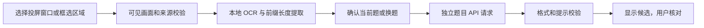

# 开发与发布

本项目只面向 Windows。请在独立目录和虚拟环境修改，保护自己的 API 密钥及 `data`。题目状态测试使用模拟请求，不需要真实 API。

## 捕获和识别流程



输入框内深色已输入字符不作为原题提示。自动换题要持续确认；手动重试独立捕获并取消旧请求，旧帧和过时 API 回复不得覆盖新结果。无确认提示的填空不复用或写入答案缓存。

## 检查

运行 README 中的模拟与界面检查。真实截图回归需要自己拥有并允许使用的样本，不应把用户提供的截图直接提交仓库。不要写入真实密钥、账号、聊天内容或整个桌面截图。

`.github/workflows/check.yml` 仅运行模拟网络与状态检查，不启动实际手机或调用真实 API；CI 结果不能替代现场验收。

## 源码包构建

`build_share.py` 只按明确文件清单打包本项目源码、说明、图标及测试，不复制运行环境、第三方软件、模型或用户数据。无需提供 Python/scrcpy 安装目录。

```powershell
python build_share.py
```

输出为 `release/<版本>/` 中的源码 ZIP 和 SHA256.txt；已有输出文件不会覆盖。依赖清单仅描述用户自行安装的组件，ZIP 不包含已安装的 `ocr_dependencies` 或 `.venv`。

公开发布采用源码加安装说明。安装软件由用户直接从对应上游获取，项目提供来源链接和本地自检。不要上传旧完整便携包。若将来决定再分发第三方二进制，需重新核对对应版本的许可证、模型来源、动态库及相应源码要求，见 THIRD_PARTY_NOTICES.md。

主项目代码使用 MIT；不要给第三方组件重新许可。Release 与源码必须对应，改代码后重新构建并记录 SHA256、验证范围和未验收项。大模型、运行环境和投屏工具不放进普通 Git 提交。
